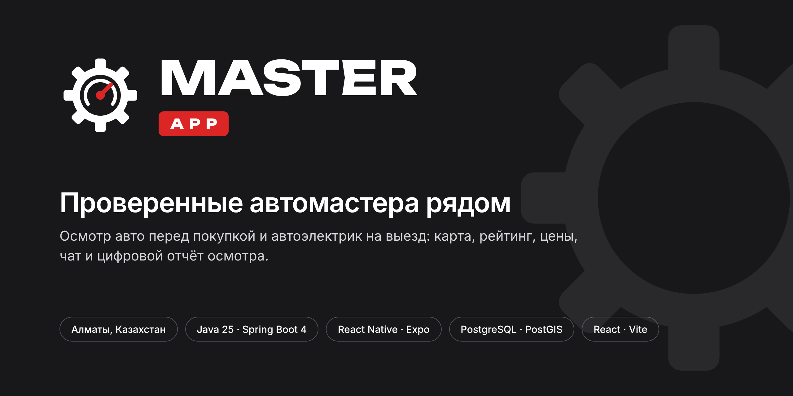
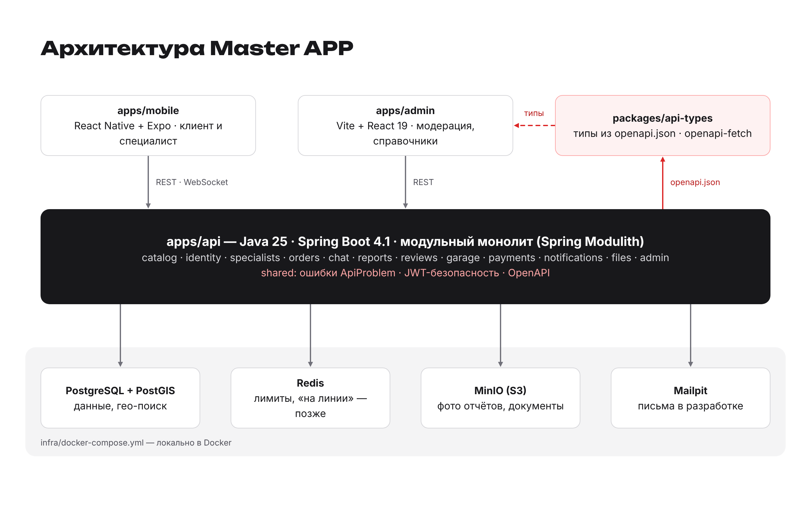

<p align="center">
  
</p>

<p align="center">
  <a href="https://github.com/nurbolatdev/master-app/actions/workflows/ci.yml"></a>
  
  
  
  
  
  <a href="LICENSE"></a>
</p>

# Master APP

**Мобильная платформа для Казахстана, где автовладелец находит проверенного автоспециалиста.** Например, автоэксперта для осмотра машины перед покупкой или автоэлектрика с выездом. Специалиста видно на карте вместе с рейтингом, отзывами и ценами. Заказ и чат с ним — прямо в приложении, а после осмотра клиент получает **цифровой отчёт осмотра**.

Приложение заменяет поиск мастеров через WhatsApp-группы и знакомых. Специалисты проходят проверку у администратора и ведут свой профиль, услуги и цены.

> Пет-проект для портфолио. Автор — [Нурболат](https://github.com/nurbolatdev). Демо — весна 2027.

## Возможности MVP

| Для клиента | Для специалиста | Для администратора |
|---|---|---|
| Поиск на карте и в списке, фильтры | Профиль, зона выезда, услуги и цены | Верификация специалистов |
| Профиль специалиста: рейтинг, отзывы, цены | Лента заявок и отклики | Справочники: города, категории |
| Заказ конкретному мастеру или открытая заявка | Статус «на линии» | Жалобы и модерация |
| Чат с маскировкой контактов | Цифровой отчёт осмотра (офлайн-черновик, фото) | |
| Отчёт осмотра со ссылкой, отзывы, «Гараж» | Push-уведомления о заказах | |

Город MVP — **Алматы**. Категории — **проверка авто перед покупкой** и **автоэлектрик/диагностика на выезд**. Вход — через Google или email. Оплата — в тестовом режиме. Интерфейс — на русском и казахском.

## Архитектура

<p align="center">
  
</p>

- **API — модульный монолит** на Spring Modulith. Модули общаются только через публичные сервисы и события, границы проверяет `ModularityTests`.
- **Контракт API** — `apps/api/openapi.json`. Из него генерируются TypeScript-типы `packages/api-types`, а мобилка и админка ходят в API только через `openapi-fetch`.
- **Ошибки** — `application/problem+json` с полем `code`, клиенты переводят их по коду.
- **Безопасность** — deny by default, JWT, `/api/v1/admin/**` доступен только роли `ADMIN`. Телефон специалиста видно только после того, как он принял заказ.

## Стек

| Часть | Технологии |
|---|---|
| `apps/api` | Java 25, Spring Boot 4.1, Spring Modulith, Spring Security (JWT), Spring Data JPA + Hibernate Spatial, Flyway, PostgreSQL + PostGIS, springdoc-openapi, Testcontainers |
| `apps/mobile` | React Native + Expo SDK 58, Expo Router, TanStack Query, openapi-fetch, i18next (ru/kk) |
| `apps/admin` | Vite + React 19, TanStack Router/Query, Tailwind CSS 4, openapi-fetch |
| `packages/api-types` | TypeScript-типы из `apps/api/openapi.json` (openapi-typescript) |
| `infra` | Docker Compose: PostGIS, Redis, MinIO, Mailpit |
| CI | GitHub Actions — тот же gate `scripts/check.sh` |

## Структура

```text
master-app/
├── apps/
│   ├── api/                 Spring Boot API
│   │   └── src/main/java/kz/masterapp/api/
│   │       ├── catalog/        города, категории (первый рабочий срез)
│   │       ├── identity/       вход, JWT                 — этап 0
│   │       ├── specialists/    профиль, верификация      — этап 1
│   │       ├── orders/ chat/   заказы, заявки, чат       — этап 3
│   │       ├── reports/        отчёт осмотра             — этап 4
│   │       ├── reviews/ garage/ payments/ notifications/ files/ admin/
│   │       └── shared/         ошибки, безопасность, OpenAPI
│   ├── mobile/              Expo: login · client/(вкладки) · specialist/(вкладки)
│   └── admin/               веб-админка
├── packages/api-types/      типы API для мобилки и админки
├── infra/docker-compose.yml локальная инфраструктура
├── scripts/check.sh         gate: все проверки одной командой
└── docs/assets/             баннер, схема, логотип
```

## Быстрый старт

Понадобится:
- **JDK 25** (`brew install --cask temurin@25`), проверка — `java -version`;
- **Docker Desktop** или **OrbStack** (должен быть запущен);
- **Node.js 22+**;
- для мобилки — Xcode (iOS) и/или Android Studio, либо Expo Go на телефоне.

```bash
git clone https://github.com/nurbolatdev/master-app.git
cd master-app
npm install          # зависимости всех TS-пакетов
npm run api:types    # сверить openapi.json с кодом и перегенерировать типы (нужен Docker)
npm run check        # gate: API + мобилка + админка → GATE PASS
```

## Разработка

```bash
npm run api:run      # API на :8080, сам поднимает infra/docker-compose.yml
npm run dev:admin    # админка: http://localhost:5173
npm run dev:mobile   # Expo; для телефона в apps/mobile/.env: EXPO_PUBLIC_API_URL=http://<IP Mac>:8080
```

| Что | Адрес |
|---|---|
| Swagger UI | http://localhost:8080/swagger-ui.html |
| OpenAPI | http://localhost:8080/v3/api-docs |
| Health | http://localhost:8080/health |
| Письма (Mailpit) | http://localhost:8025 |
| MinIO консоль | http://localhost:9001 |

Изменили API → `npm run api:types`: обновятся `apps/api/openapi.json` и `packages/api-types/src/schema.ts`.

## Roadmap

| Этап | Когда | Результат | Статус |
|---|---|---|---|
| 0. Фундамент | ноябрь 2026 | Монорепо, API + PostGIS, CI, вход и JWT, каркасы мобилки и админки | 🟡 в работе |
| 1. Специалисты | декабрь | Профиль, услуги, верификация, модерация в админке | ⚪ |
| 2. Мобилка: поиск | январь | Карта, список, фильтры, профиль специалиста | ⚪ |
| 3. Заказы и чат | февраль | Полный цикл заказа, push, WebSocket-чат | ⚪ |
| 4. Отчёт и отзывы | март | Цифровой отчёт осмотра, отзывы, гараж | ⚪ |
| 5. Оплата и деплой | апрель | Тестовая оплата, деплой демо | ⚪ |
| 6. Упаковка | май | Тесты, видео-демо, APK | ⚪ |

## Как ведётся работа

- Одна задача = одна ветка `feature/<id>-<кратко>` от `develop` = один PR в `develop` с отчётом по шаблону `.github/pull_request_template.md`.
- Каждая задача — **вертикальный срез**: миграция → домен → API → типы → экран → тесты, до ~400 строк кода без тестов.
- Перед PR нужен `npm run check` с результатом **GATE PASS**. CI на GitHub запускает те же проверки.
- Секреты лежат только в `.env` (он в `.gitignore`), шаблоны — в `.env.example`.

## Бренд


Знак — шестерня со стрелкой спидометра: мастер чинит, и машина снова на ходу. Надпись — `MASTER` + `APP` в красной плашке, шрифт Unbounded.<br>
Цвета: `#DC2626` (акцент) и `#18181B` (основной тёмный). Логотипы — в [`docs/assets/brand`](docs/assets/brand), иконки приложения — в [`apps/mobile/assets/brand`](apps/mobile/assets/brand).

<br clear="left">

## Документация

Продуктовый анализ, решения (ADR), roadmap и дневник разработки ведутся в отдельном Obsidian-хранилище **Master App** (точка входа — заметка `00 Home`).

## Лицензия

[MIT](LICENSE) © 2026 Nurbolat ([@nurbolatdev](https://github.com/nurbolatdev))

---

<p align="center">Сделано в Алматы · <a href="https://github.com/nurbolatdev">@nurbolatdev</a></p>
