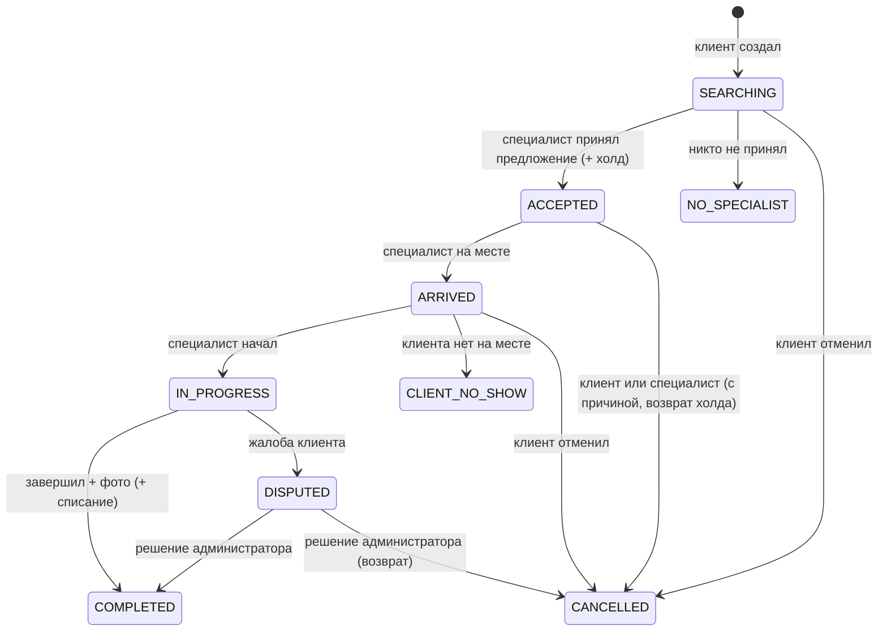

# Срочная техпомощь — подбор специалиста и трекинг

> **Статус: планируется (фаза 2).** В MVP не входит. Раздел 9 — приёмы, которые закладываются уже в MVP.
> Связанные решения: ADR-020 (геопозиция специалиста в заказе), ADR-021 (фоновая геолокация через `expo-location`).

Сценарий: «сломался на дороге» → клиент жмёт «Нужна помощь сейчас» → система предлагает заказ ближайшему специалисту на линии → принявший едет, клиент видит его на карте → работа → фото результата → отзыв.

## 1. Отличия от обычного заказа

| | Обычный заказ | Срочный заказ |
|---|---|---|
| Кто выбирает специалиста | Клиент (напрямую или через отклики) | Система, по расстоянию |
| Время | `scheduled_at` в будущем | Сейчас |
| Ожидание ответа | До 30 мин (`EXPIRED`) | 30 с на одного специалиста |
| Геопозиция специалиста | Не показывается | Живая, только пока специалист едет |
| Подтверждение работы | Отчёт осмотра (`requires_report`) | Фото «после» обязательно |

Тип заказа — поле `customer_order.kind`: `SCHEDULED` (по умолчанию) | `URGENT`. Разрешённые переходы выбираются по `kind`.

## 2. Статусы срочного заказа



| Статус | Клиент видит | Уведомление клиенту |
|---|---|---|
| `SEARCHING` | «Ищем специалиста рядом…» | — |
| `ACCEPTED` | Специалист, телефон, точка на карте, ETA | «{имя} принял вызов и едет» |
| событие «подъезжает» (< 400 м) | — | «Специалист будет через минуту» (один раз) |
| `ARRIVED` | «Специалист на месте» | да |
| `COMPLETED` | Фото, итоговая сумма, «Оцените» | да |
| `NO_SPECIALIST` | «Свободных специалистов нет, попробуйте позже» | да |
| `CLIENT_NO_SHOW` | Причина | да |

Правила:
- Строгие переходы: недопустимый → `409`, `ErrorCode.INVALID_STATUS_TRANSITION`.
- Каждый переход — запись в `order_status_history` (с точкой специалиста, если есть) и событие `OrderStatusChanged`.
- Оплата: холд при `ACCEPTED`, списание при `COMPLETED` через `PaymentProvider`.

## 3. Подбор специалиста

### 3.1. Кандидаты
- `specialist_profile.online_until > now()` — специалист «на линии».
- `visible = true`, есть активная услуга нужной категории.
- Нет заказа в `ACCEPTED`, `ARRIVED`, `IN_PROGRESS`.
- Последняя точка свежее 5 мин и в радиусе выезда.
- Ещё не получал предложение по этому заказу.

Сортировка: расстояние, затем `rating_avg`.

```sql
SELECT sp.user_id, ST_Distance(sp.last_point, :p) AS distance_m
FROM specialist_profile sp
WHERE sp.visible
  AND sp.online_until > now()
  AND sp.last_point_at > now() - interval '5 minutes'
  AND ST_DWithin(sp.last_point, :p, sp.service_radius_km * 1000)
  AND EXISTS (SELECT 1 FROM service_offer so
              WHERE so.specialist_id = sp.user_id AND so.category_id = :cat AND so.active)
  AND NOT EXISTS (SELECT 1 FROM customer_order o
                  WHERE o.specialist_id = sp.user_id AND o.status IN ('ACCEPTED','ARRIVED','IN_PROGRESS'))
  AND NOT EXISTS (SELECT 1 FROM dispatch_offer d
                  WHERE d.order_id = :orderId AND d.specialist_id = sp.user_id)
ORDER BY distance_m, sp.rating_avg DESC
LIMIT 1;
```

### 3.2. Стратегии
- **По очереди** (основная): один ближайший кандидат получает предложение на 30 с; отказ или таймаут → следующий; кандидатов нет → `NO_SPECIALIST`.
- **Всем сразу** (запасная, включается настройкой): предложение видят все кандидаты в радиусе, забирает первый.
- Общий лимит поиска — 5 мин, затем `NO_SPECIALIST`.

### 3.3. `dispatch_offer`
Отдельная сущность, не путать с `offer` (отклики на открытую заявку).

| Поле | Назначение |
|---|---|
| `id`, `order_id`, `specialist_id` | уникальность `(order_id, specialist_id)` |
| `status` | `PENDING` / `ACCEPTED` / `DECLINED` / `EXPIRED` / `CLOSED` |
| `distance_m` | расстояние в момент предложения |
| `expires_at`, `responded_at` | |

### 3.4. Надёжность
- **Гонка при принятии** — одно условное обновление:
  `UPDATE dispatch_offer SET status = 'ACCEPTED' WHERE id = ? AND status = 'PENDING' AND expires_at > now()`.
  0 строк → `409 OFFER_TAKEN` или `410 OFFER_EXPIRED`. Плюс `@Version` на заказе.
- **Таймаут** — отложенная задача на `expires_at` и подстраховка `@Scheduled` (раз в 15–30 с) для «зависших» `PENDING`.
- **Закрытие** — заказ принят или отменён → всем с открытым предложением событие `dispatch.offer_closed`.

## 4. Живая геопозиция специалиста

**API**
- `POST /api/v1/specialists/me/location` → `{ latitude, longitude, accuracy, heading, speed }`.
- Обновляет `specialist_profile.last_point`, `last_point_at`, продлевает `online_until`. Эти поля не отдаются в каталог: там остаётся смещённая точка района.
- Если у специалиста заказ в `ACCEPTED` — точка пишется в `order_position` и уходит клиенту по WebSocket; проверяется событие «подъезжает».
- Не чаще 1 запроса в 3 с на специалиста.
- `order_position` хранится ограниченный срок (для разбора споров), затем удаляется задачей.

**Мобилка, специалист** (`expo-location` + `expo-task-manager`, на Android — foreground service):
- «На линии» без заказа: раз в 1–2 мин или при сдвиге ≥ 100 м.
- Заказ в `ACCEPTED`: каждые 5–10 с или при сдвиге 15–25 м.
- `ARRIVED`, отмена, завершение → частая передача выключается.

**Мобилка, клиент:** точка специалиста с плавным перемещением и ETA; при обрыве WebSocket — `GET /api/v1/orders/{id}/tracking`.

## 5. Realtime-события (STOMP, личные очереди)

| Очередь | Событие | Кому |
|---|---|---|
| `/user/queue/dispatch` | `dispatch.offer` | специалисту с предложением |
| `/user/queue/dispatch` | `dispatch.offer_closed` (`ACCEPTED_BY_OTHER` / `CANCELLED` / `EXPIRED`) | специалисту |
| `/user/queue/orders` | `order.status_changed` | клиенту и специалисту заказа |
| `/user/queue/orders` | `order.specialist_location` (`lat`, `lng`, `heading`, `eta_sec`) | клиенту заказа |

Свёрнутое приложение → те же события дублируются push. WebSocket — сигнал, REST — источник правды.

## 6. Фото результата
- `POST /api/v1/orders/{id}/photos` (`kind`: `BEFORE` / `AFTER`).
- `URGENT` → `COMPLETED` без хотя бы одного `AFTER` → `409 PHOTO_REQUIRED`.
- Отзыв и чат — существующие `review` и `chat` (чат открывается при `ACCEPTED`).

## 7. API

**Клиент**

| Метод | Путь | Что делает |
|---|---|---|
| POST | `/api/v1/orders/urgent` | Создать срочный заказ → `SEARCHING` |
| POST | `/api/v1/orders/{id}/cancel` | Отменить, если разрешено статусом |
| GET | `/api/v1/orders/{id}/tracking` | Последняя точка специалиста и ETA (только в `ACCEPTED`) |

**Специалист**

| Метод | Путь | Что делает |
|---|---|---|
| POST | `/api/v1/specialists/me/online` | На линии / не на линии |
| POST | `/api/v1/specialists/me/location` | Геопозиция |
| GET | `/api/v1/dispatch-offers/current` | Открытое предложение |
| POST | `/api/v1/dispatch-offers/{id}/accept` | Принять |
| POST | `/api/v1/dispatch-offers/{id}/decline` | Отказаться |
| POST | `/api/v1/orders/{id}/transitions` | `{ "to": "ARRIVED" }` |
| GET | `/api/v1/orders/{id}/actions` | Доступные действия текущего пользователя |
| POST | `/api/v1/orders/{id}/photos` | Фото |

Новые `ErrorCode`: `INVALID_STATUS_TRANSITION`, `OFFER_TAKEN`, `OFFER_EXPIRED`, `PHOTO_REQUIRED`, `SPECIALIST_OFFLINE` (с переводами ru и kk).

## 8. Модель данных

| Таблица | Изменение |
|---|---|
| `customer_order` | `kind`, `accepted_at`, `arrived_at` |
| `specialist_profile` | `last_point geography(Point, 4326)` + GiST, `last_point_at` |
| `order_status_history` | `point geography(Point, 4326)` |
| `dispatch_offer` | новая (3.3) |
| `order_position` | новая: `order_id, specialist_id, point, heading, speed, accuracy, recorded_at` |
| `order_photo` | новая: `id, order_id, file_key, kind, comment, created_at` |

## 9. Что закладывается уже в MVP

1. **Действия от сервера.** `GET /api/v1/orders/{id}/actions` возвращает доступные текущему пользователю переходы; мобилка рисует кнопки по ответу, правила — только на бэкенде.
2. **Переходы как данные.** Один класс с картой «статус → разрешённые статусы + кто может» на каждый `kind`; срочный заказ добавляется новой картой.
3. **Подстраховка таймаутов.** `EXPIRED` — отложенная задача и `@Scheduled`-проверка просроченных `CREATED`.
4. **Точка в истории статусов** — для разбора споров в админке.

```java
public final class OrderTransitions {
    record Rule(OrderStatus to, Set<Actor> who) {}

    private static final Map<OrderStatus, List<Rule>> URGENT = Map.of(
        SEARCHING,   List.of(new Rule(ACCEPTED, Set.of(SYSTEM)), new Rule(NO_SPECIALIST, Set.of(SYSTEM)),
                             new Rule(CANCELLED, Set.of(CLIENT))),
        ACCEPTED,    List.of(new Rule(ARRIVED, Set.of(SPECIALIST)), new Rule(CANCELLED, Set.of(CLIENT, SPECIALIST))),
        ARRIVED,     List.of(new Rule(IN_PROGRESS, Set.of(SPECIALIST)), new Rule(CLIENT_NO_SHOW, Set.of(SPECIALIST)),
                             new Rule(CANCELLED, Set.of(CLIENT))),
        IN_PROGRESS, List.of(new Rule(COMPLETED, Set.of(SPECIALIST)), new Rule(DISPUTED, Set.of(CLIENT)))
    );
}
```

## 10. Порядок внедрения (фаза 2)

1. `kind`, таблица переходов, `/actions` (можно в MVP).
2. «На линии», `POST /specialists/me/location`, `last_point`.
3. `dispatch_offer`, подбор по очереди, таймауты, закрытие предложений.
4. Realtime: предложение специалисту, статус и точка клиенту.
5. Фоновая геолокация в мобилке.
6. Фото результата, событие «подъезжает», push.
7. Админка: срочные заказы на карте, история точек в споре.
