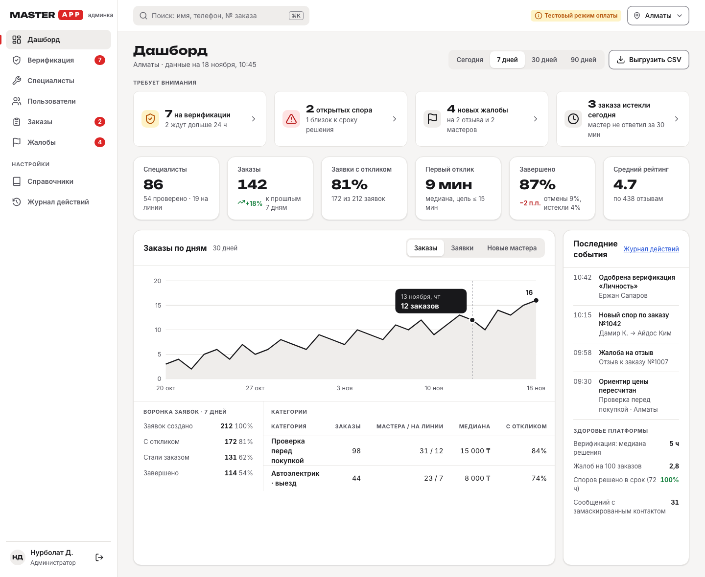

# 01 · Дашборд

Эталон: [`../reference/screens/01-dashboard.html`](../reference/screens/01-dashboard.html) · маршрут `/` · API `GET /api/v1/admin/dashboard?city=&period=`

Задача: за 10 секунд ответить «что горит» и «растёт ли платформа».

## Разметка сверху вниз

1. **Заголовок** «Дашборд» + «Алматы · данные на 18 ноября, 10:45». Справа сегмент периода (Сегодня / 7 / 30 / 90 дней, по умолчанию 7) и `secondary` «Выгрузить CSV».
2. **«Требует внимания»** — overline + 4 плитки в ряд (сетка 4 колонки, зазор 16). Плитка = ссылка в очередь с фильтром:
   | Плитка | Число | Подпись | Иконка/тинт | Ведёт |
   |---|---|---|---|---|
   | Верификация | ждут проверки | «N ждут дольше 24 ч» | shield-check, `warning-tint` | `/verifications` |
   | Споры | открытые `DISPUTED` | «N близки к сроку решения» (< 24 ч до 72 ч) | alert-triangle, `brand-tint` | `/orders?status=DISPUTED` |
   | Жалобы | новые | разбивка по типам | flag, `surface-2` | `/complaints?state=new` |
   | Истёкшие заказы | `EXPIRED` за сегодня | «мастер не ответил за 30 мин» | clock, `surface-2` | `/orders?status=EXPIRED&date=today` |
   Плитка с нулём остаётся, но число `ink-3` и подпись «Всё разобрано».
3. **KPI** — 6 плиток (сетка 6 колонок):
   | KPI | Формула | Пояснение под числом |
   |---|---|---|
   | Специалисты | всего в городе | «X проверено · Y на линии» |
   | Заказы | созданные за период | изменение к прошлому такому же периоду, стрелка `success`/`brand-text` |
   | Заявки с откликом | заявки с ≥ 1 откликом / все заявки | «172 из 212 заявок» — главная метрика ликвидности |
   | Первый отклик | медиана минут от заявки до первого отклика | «медиана, цель ≤ 15 мин» |
   | Завершено | `COMPLETED` / (все заказы − открытые) | «отмены X%, истекли Y%» |
   | Средний рейтинг | среднее по отзывам за всё время | «по N отзывам» |
4. **Две колонки** (1.55fr | 1fr):
   - Слева карточка «Заказы по дням»: сегмент метрики (Заказы / Заявки / Новые мастера), **одна** линия цвета `ink` 2 px с заливкой `surface-2`, сетка `border`, подписи осей 11 `ink-2`, последнее значение подписано, при наведении — вертикальная пунктирная линия и тёмная подсказка «13 ноября, чт · 12 заказов». Никаких двух осей. Под графиком — две половины: **воронка заявок** (горизонтальные полосы `ink` на `surface-2`, 24 высотой: создано → с откликом → стали заказом → завершено, число и %) и **таблица категорий** (заказы, мастера / на линии, медианная цена, доля заявок с откликом).
   - Справа карточка «Последние события» (4–6 строк журнала: время, действие, объект; ссылка «Журнал действий») и блок «Здоровье платформы»: медиана решения верификации, жалоб на 100 заказов, споров решено в срок (72 ч), сообщений с замаскированным контактом.

## Поведение

- Смена периода/города перезапрашивает всё; URL `?period=7d&city=almaty`.
- Таблица под графиком — доступная альтернатива графику (кнопка «Таблицей» для скринридера).
- Данные кэшируются на 1 минуту; время «данные на …» обновляется.

## Состояния

Загрузка — скелетоны плиток и прямоугольник графика. Нет данных за период — в графике «Пока нет заказов за этот период». Ошибка — Banner danger над KPI + «Повторить».
