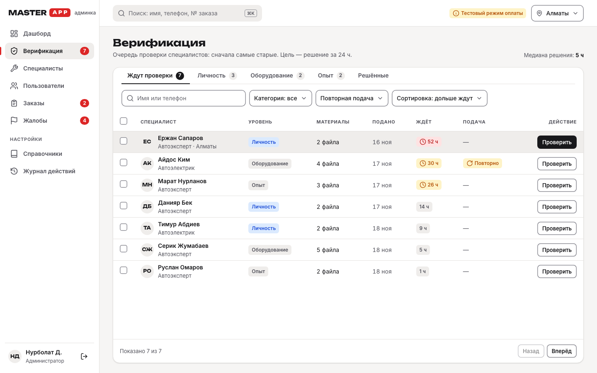
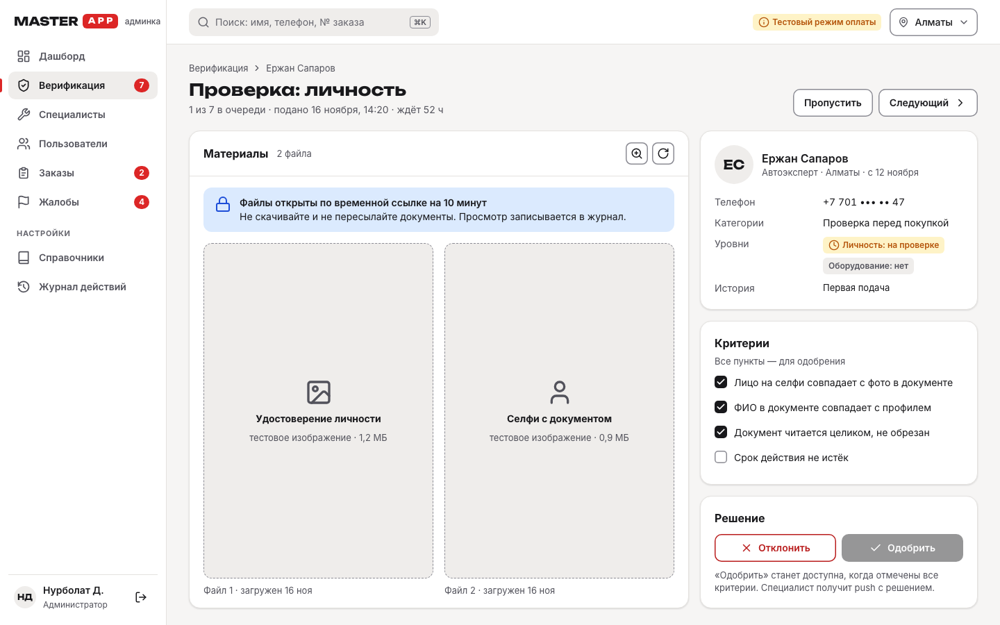

# 02–03 · Верификация

Эталоны: [`02-verification-queue.html`](../reference/screens/02-verification-queue.html), [`03-verification-review.html`](../reference/screens/03-verification-review.html) · API `/api/v1/admin/verifications/*`

Три независимых уровня (см. продуктовую заметку «Верификация специалистов»): **Личность** (удостоверение + селфи), **Оборудование** (фото инструмента), **Опыт** (примеры отчётов, профиль Kolesa/Kaspi). Каждый одобряется отдельно и даёт свой значок.

## Очередь

- Заголовок + подзаголовок «Очередь проверки специалистов: сначала самые старые. Цель — решение за 24 ч.» Справа — медиана решения.
- Вкладки: Ждут проверки (все) · Личность · Оборудование · Опыт · Решённые — со счётчиками.
- Фильтры: поиск (имя/телефон), категория, «Повторная подача», сортировка (по умолчанию — дольше ждут).
- Таблица: чекбокс · Специалист (аватар, имя, специализация, город) · Уровень (бейдж: Личность — `trust`, остальные — `neutral`) · Материалы («2 файла») · Подано (дата) · Ждёт (SLA-бейдж) · Подача («Повторно» `warning` с иконкой, если раньше отклоняли) · «Проверить» (первая строка — `primary`, остальные — `secondary`).
- Открытие заявки **блокирует** её за администратором (чтобы двое не проверяли одно), блокировка снимается через 15 минут без действий.

## Проверка

Две колонки (1fr | 400):
- **Материалы** (слева): шапка «Материалы · 2 файла» + кнопки «Увеличить», «Повернуть». Banner info: «Файлы открыты по временной ссылке на 10 минут. Не скачивайте и не пересылайте. Просмотр записывается в журнал.» Ниже — превью файлов в ряд (для «Оборудования» и «Опыта» — сетка до 6 штук), подпись «Файл N · загружен …». Клик — полноэкранный просмотр с зумом и поворотом.
- **Справа сверху вниз:** карточка специалиста (аватар 56, имя, специализация, город, дата регистрации; телефон замаскирован; категории; статусы уровней; история подач с прошлыми причинами отказа) → карточка **«Критерии»** (чек-лист; для Личности: лицо совпадает, ФИО совпадает, документ читается целиком, срок действия не истёк; для Оборудования: оборудование соответствует услугам, фото не из интернета; для Опыта: отчёты принадлежат специалисту, отзывы правдоподобны) → карточка **«Решение»**: `danger-outline` «Отклонить» и `primary` «Одобрить». «Одобрить» активна, только когда отмечены все критерии; подпись объясняет это.
- «Отклонить» открывает окно: причина-пресет (Плохо видно документ, Лицо не совпадает, ФИО не совпадает, Документ просрочен, Фото из интернета, Отчёты не принадлежат специалисту, Другое) + комментарий для специалиста (обязательно) → «Отклонить и уведомить».
- Сверху справа: «Пропустить» (вернуть в очередь) и «Следующий» (`J`).
- После решения — тост «Решение отправлено» и сразу следующая заявка из очереди.

## Тексты для специалиста (push)

Одобрено: «Уровень «Личность» подтверждён — значок появился в профиле». Отклонено: «Уровень «Личность» не подтверждён: {причина}. Загрузите материалы заново».
