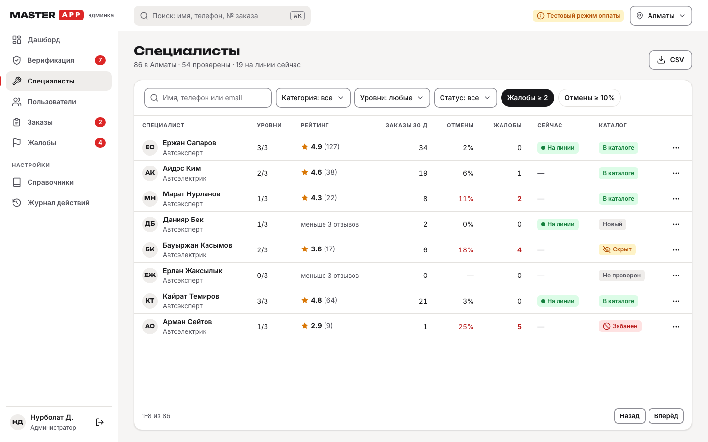
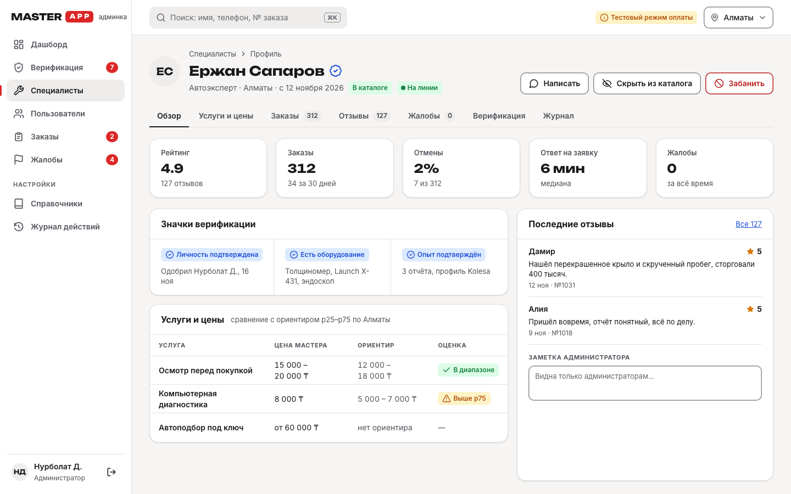

# 04–05 · Специалисты

Эталоны: [`04-specialists.html`](../reference/screens/04-specialists.html), [`05-specialist-profile.html`](../reference/screens/05-specialist-profile.html) · API `/api/v1/admin/specialists*`

## Список

- Подзаголовок: «86 в Алматы · 54 проверены · 19 на линии сейчас». Справа CSV.
- Фильтры: поиск (имя, телефон, email), Категория, Уровни (0–3), Статус каталога; быстрые чипы «Жалобы ≥ 2», «Отмены ≥ 10%» — это сигналы плохого качества, ради которых раздел и открывают.
- Колонки: Специалист · Уровни («2/3») · Рейтинг (звезда + число + количество; «меньше 3 отзывов», если рейтинг ещё не показывается) · Заказы 30 д · Отмены (≥ 10% — `brand-text`) · Жалобы (≥ 2 — `brand-text` 700) · Сейчас (бейдж «На линии») · Каталог (статус) · меню «…» (Открыть, Скрыть из каталога, Забанить).
- Сортировка по любой числовой колонке, по умолчанию — по жалобам, затем отменам.

## Профиль

- Шапка: аватар 56, хлебные крошки, имя (Unbounded 24) + значок «Проверен», строка «Автоэксперт · Алматы · с 12 ноября 2026» + бейджи каталога и «На линии». Действия справа: `secondary` «Написать» (служебный чат от имени поддержки), `secondary` «Скрыть из каталога» (с причиной, обратимо), `danger-outline` «Забанить» (окно бана из раздела 06).
- Вкладки: Обзор · Услуги и цены · Заказы · Отзывы · Жалобы · Верификация · Журнал (действия админов над этим человеком).
- **Обзор:** 5 KPI (рейтинг, заказы, отмены, медиана ответа на заявку, жалобы) → «Значки верификации» (3 колонки: уровень, кто и когда одобрил, что именно) → «Услуги и цены» с колонкой **«Оценка»**: цена мастера сравнивается с ориентиром p25–p75 города (`success` «В диапазоне», `warning` «Выше p75» / «Ниже p25», «—» если ориентира нет) → справа последние отзывы и «Заметка администратора» (видна только админам).
- Скрытый из каталога специалист продолжает выполнять уже принятые заказы; новые заявки не получает.
