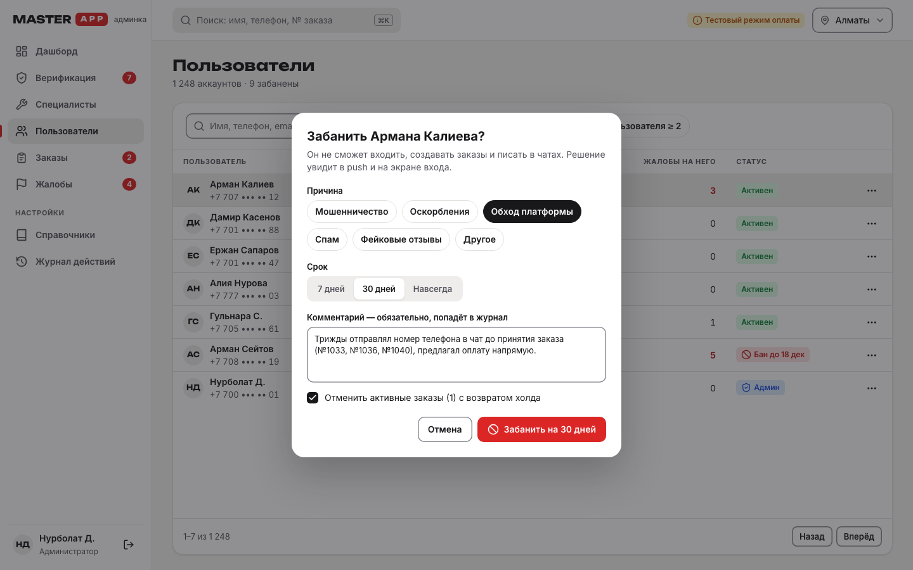

# 06 · Пользователи и бан

Эталон: [`06-users-ban.html`](../reference/screens/06-users-ban.html) · API `/api/v1/admin/users/*`

## Список

- Подзаголовок «1 248 аккаунтов · 9 забанены». Фильтры: поиск (имя, телефон, email), роль (Клиент / Специалист / Администратор), статус, чип «Жалобы на пользователя ≥ 2».
- Колонки: Пользователь (имя + замаскированный телефон) · Роли (через запятую: один аккаунт бывает и клиентом, и специалистом) · Регистрация · Заказы · Жалобы на него (≥ 2 — `brand-text`) · Статус (`success` «Активен» / `danger` «Бан до 18 дек» / `trust` «Админ») · меню.

## Окно бана

- Заголовок-вопрос с именем: «Забанить Армана Калиева?» + последствия: «Он не сможет входить, создавать заказы и писать в чатах. Решение увидит в push и на экране входа.»
- **Причина** — чипы, один выбор: Мошенничество, Оскорбления, Обход платформы, Спам, Фейковые отзывы, Другое.
- **Срок** — сегмент: 7 дней / 30 дней / Навсегда.
- **Комментарий** — обязательно, попадает в журнал (и, сокращённо, пользователю).
- Чекбокс «Отменить активные заказы (N) с возвратом холда» — по умолчанию включён, если активные заказы есть.
- Кнопки: `secondary` «Отмена», `danger-solid` «Забанить на 30 дней» (текст повторяет срок). Без причины и комментария кнопка неактивна.
- Разбан — из меню строки, окно с причиной, запись в журнал.
- Администратора забанить нельзя (пункт меню скрыт).
