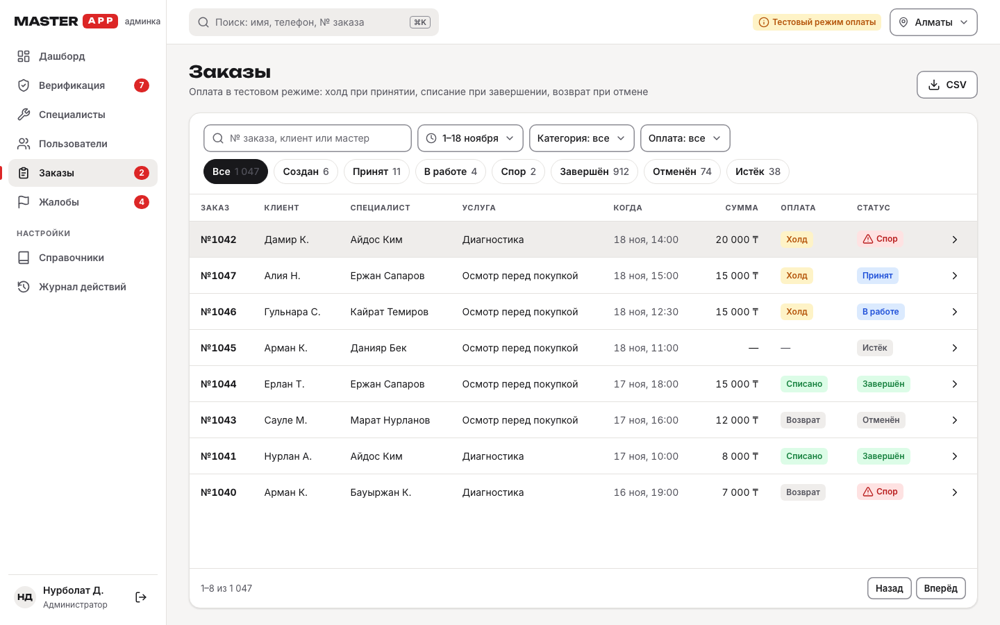
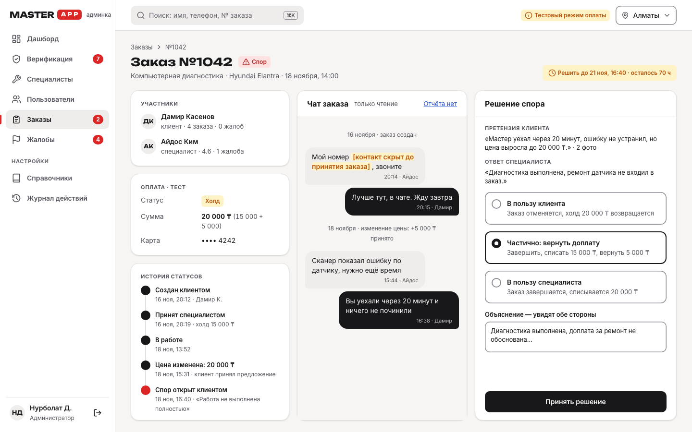

# 07–08 · Заказы и споры

Эталоны: [`07-orders.html`](../reference/screens/07-orders.html), [`08-order-dispute.html`](../reference/screens/08-order-dispute.html) · API `/api/v1/admin/orders*`

## Список

- Подзаголовок напоминает модель оплаты: «Оплата в тестовом режиме: холд при принятии, списание при завершении, возврат при отмене».
- Фильтры: поиск (№, клиент, мастер), период, категория, оплата. Ниже — чипы статусов со счётчиками: Все · Создан · Принят · В работе · **Спор** · Завершён · Отменён · Истёк.
- Колонки: Заказ (№, жирный) · Клиент · Специалист · Услуга · Когда · Сумма (справа) · Оплата (бейдж) · Статус (бейдж; «Спор» — `danger` с иконкой) · шеврон. Строка-спор подсвечена `surface-2`.
- Сортировка по умолчанию — споры сверху, потом по дате.

## Спор

- Шапка: крошки, «Заказ №1042» + бейдж «Спор», строка «услуга · машина · дата»; справа **таймер срока** решения (72 ч от открытия): `warning`, при < 24 ч — `brand-tint`.
- **Три колонки** (330 | 1fr | 420):
  1. Участники (клиент и специалист со счётчиками заказов и жалоб; клик — их профили) → «Оплата · тест» (статус, сумма с разбивкой, последние 4 цифры карты) → «История статусов» (вертикальная линия, точки `ink`, последняя — `brand`; каждое событие с временем и деталью, включая принятые изменения цены).
  2. **Чат заказа — только чтение**, как в мобилке, с видимыми масками контактов и системными сообщениями. Ссылка на отчёт осмотра, если есть.
  3. **Решение спора:** претензия клиента (текст + фото), ответ специалиста → три радио-карточки с последствиями для денег: «В пользу клиента» (отмена, возврат всей суммы), «Частично: вернуть доплату» (завершить, списать исходную цену, вернуть разницу — только если цена менялась), «В пользу специалиста» (завершить, списать всё) → «Объяснение — увидят обе стороны» (обязательно) → `primary` «Принять решение» (окно подтверждения с итоговой суммой).
- После решения: статус `COMPLETED` или `CANCELLED`, оплата `CAPTURED`/`REFUNDED`, push обеим сторонам с объяснением, запись в журнал.
