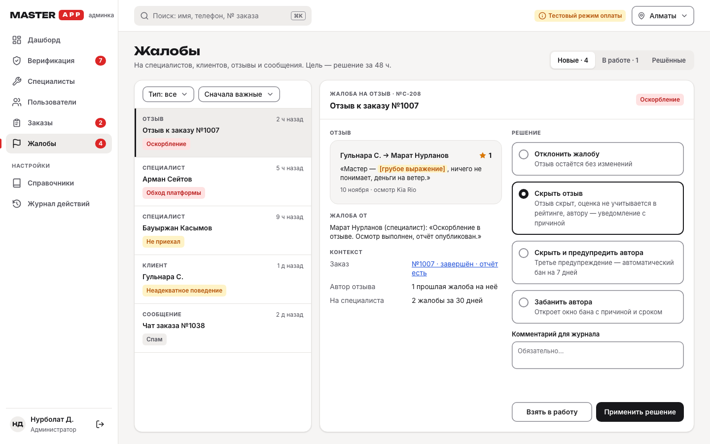

# 09 · Жалобы

Эталон: [`09-complaints.html`](../reference/screens/09-complaints.html) · API `/api/v1/admin/complaints/*`

Жалобы бывают на **специалиста, клиента, отзыв и сообщение в чате**. Отдельного раздела «Отзывы» нет — отзывы модерируются через жалобы и вкладку «Отзывы» в профиле специалиста.

## Разметка: список + карточка (master–detail)

- Справа в шапке сегмент: Новые · В работе · Решённые. Цель в подзаголовке — решение за 48 ч.
- **Слева (360):** фильтры (тип, сортировка «Сначала важные») и список: overline-тип, «N ч назад», объект (600), бейдж причины (тон по тяжести: оскорбление / обход платформы / мошенничество — `danger`; не приехал / поведение — `warning`; спам — `neutral`). Выбранная — фон `surface-2` и внутренняя риска 3 `ink` слева.
- **Справа — карточка жалобы:** шапка (тип + номер, объект, бейдж причины). Две колонки:
  - Объект жалобы (для отзыва — сам отзыв с оценкой, автором, датой, машиной; запрещённые слова под маской), текст жалобы и кто её подал, **контекст** (заказ со статусом и наличием отчёта, прошлые жалобы на автора и на объект).
  - **Решение** — радио-карточки: Отклонить жалобу · Скрыть отзыв (оценка перестаёт влиять на рейтинг, автору — уведомление) · Скрыть и предупредить автора (третье предупреждение = автоматический бан 7 дней) · Забанить автора (открывает окно бана). Для жалоб на людей: Отклонить · Предупредить · Скрыть из каталога · Забанить. Комментарий для журнала обязателен.
  - Кнопки: `secondary` «Взять в работу» (назначает жалобу на себя), `primary` «Применить решение».
- После решения — следующая жалоба открывается автоматически, тост с «Отменить» (5 с).
