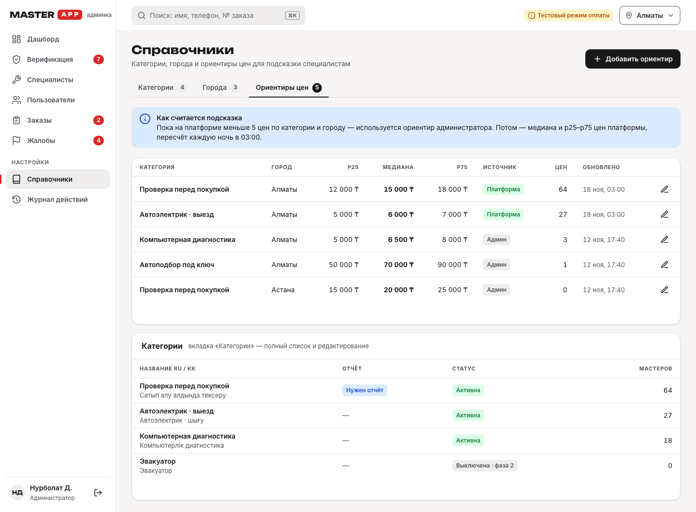

# 10 · Справочники

Эталон: [`10-references.html`](../reference/screens/10-references.html) · API `/api/v1/admin/categories`, `/cities`, `/price-benchmarks`

Вкладки: **Категории · Города · Ориентиры цен**. На эталоне открыта вкладка ориентиров, под ней — краткая таблица категорий.

## Ориентиры цен

- Banner info «Как считается подсказка»: пока цен по категории и городу на платформе меньше 5 — используется ориентир администратора; потом — медиана и p25–p75 цен платформы, пересчёт каждую ночь в 03:00.
- Таблица: Категория · Город · p25 · **Медиана** (жирная) · p75 · Источник (`success` «Платформа» / `neutral` «Админ») · Цен (сколько цен на платформе) · Обновлено · «Изменить».
- «Добавить ориентир» / «Изменить» — боковая панель 440: категория, город, мин., макс., комментарий. Ориентир с источником «Платформа» редактировать нельзя (поля заблокированы, подсказка почему); можно только «Зафиксировать вручную» с причиной.

## Категории

Колонки: название ru и kk (обе строки обязательны) · «Нужен отчёт» (`requires_report`: завершить заказ можно только после отчёта) · статус (Активна / Выключена) · мастеров. Создание и редактирование — боковая панель; выключенная категория скрыта в приложении, но существующие заказы не трогаются.

## Города

Название ru/kk, центр карты (координаты), активен ли. В MVP активен только Алматы.
