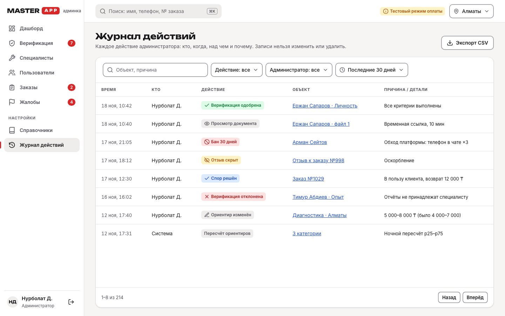

# 11 · Журнал действий (новый раздел)

Эталон: [`11-audit-log.html`](../reference/screens/11-audit-log.html) · маршрут `/audit` · API `GET /api/v1/admin/audit?action=&adminId=&from=&to=&q=`

Зачем: каждое решение администратора должно быть объяснимо — при споре о бане, при жалобе пользователя, для самоконтроля. Записи **только добавляются**, изменить или удалить их нельзя.

## Что пишется

| Действие | Объект | Детали |
|---|---|---|
| Верификация одобрена / отклонена | специалист + уровень | причина |
| Просмотр документа | файл | срок временной ссылки |
| Показ полного телефона | пользователь | — |
| Бан / разбан | пользователь | причина, срок, комментарий, отменённые заказы |
| Скрыт / возвращён в каталог | специалист | причина |
| Отзыв скрыт / возвращён | отзыв | причина |
| Жалоба решена | жалоба | решение, комментарий |
| Спор решён | заказ | исход, суммы, объяснение |
| Справочник изменён | категория / город / ориентир | было → стало |
| Система | пересчёт ориентиров, автоматический бан | — |

## Разметка

Фильтры: поиск по объекту и причине, тип действия, администратор, период; «Экспорт CSV». Таблица: Время · Кто · Действие (бейдж с иконкой: одобрение — `success`, бан и отклонение — `danger`, скрытие — `warning`, решение спора — `trust`, просмотры и правки — `neutral`) · Объект (ссылка) · Причина / детали.

## Для бэкенда

Таблица `admin_audit_log`: `id, admin_id (null для системы), action, target_type, target_id, reason, details jsonb, created_at`. Запись — в той же транзакции, что и действие. Персональные данные в `details` не хранить (только идентификаторы).
