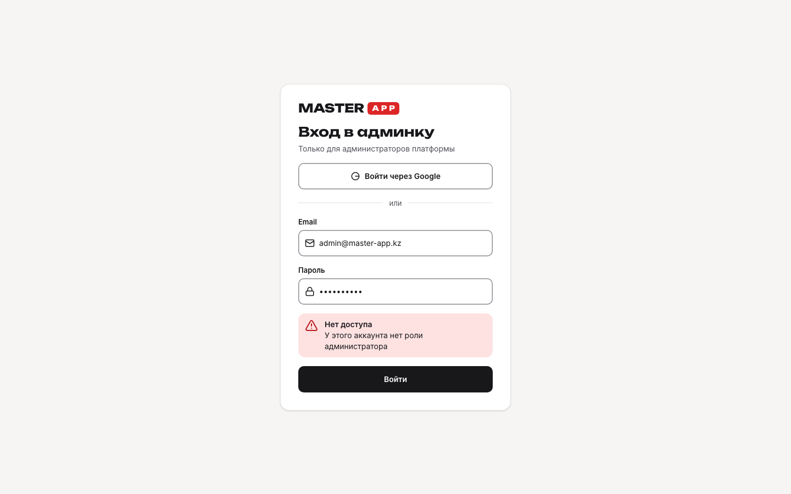

# 12 · Вход

Эталон: [`12-login.html`](../reference/screens/12-login.html) · маршрут `/login`

- По центру карточка 420, паддинг 32: словесный знак (файл логотипа) → заголовок Unbounded 24 «Вход в админку» + «Только для администраторов платформы» → `secondary` 48 «Войти через Google» → разделитель «или» → поля Email и Пароль (48) → `primary` 48 «Войти».
- Ошибка роли: Banner danger «Нет доступа · У этого аккаунта нет роли администратора» (сервер отвечает 403). Неверный пароль — ошибка под полем пароля.
- После входа — возврат на страницу, с которой перебросило на вход (`?redirect=`).
- Сессия админа короче пользовательской (8 ч), при истечении — возврат на вход с сохранением адреса.
