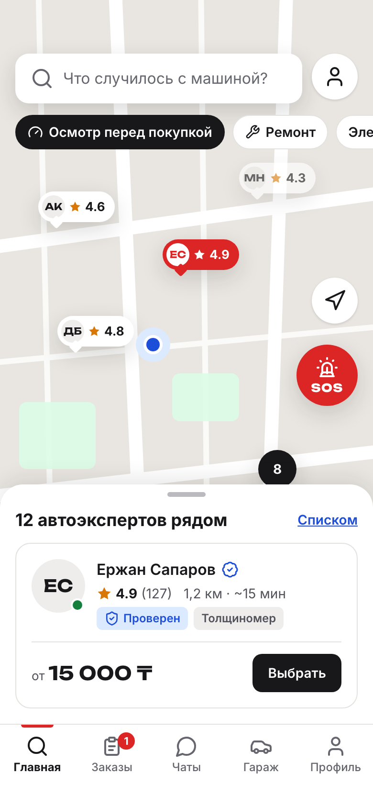

# 01 · Главная: карта и мастера

- Эталон: [`../reference/screens/01-client-home.html`](../reference/screens/01-client-home.html)
- Маршрут: `src/app/client/index.tsx`, вкладка «Главная» (таб-бар клиента виден).
- Задача экрана: за 5 секунд показать проверенных мастеров рядом с ценой и рейтингом и дать заказать; срочным — SOS в одно нажатие.

## Слои (снизу вверх)

1. **Карта** на весь экран (заглушка до загрузки — `mapBg`). Провайдер выбирается отдельно.
2. **Элементы над картой** (`zIndex.mapControls`).
3. **Шторка** (`zIndex.sheet`).
4. **Таб-бар** (`zIndex.tabbar`).

## Разметка

| Элемент | Позиция на эталоне (x, y, w×h) | Спецификация |
|---|---|---|
| Поиск | 16, 56, 274×52 | Фон `surface`, скругление 14, `shadow.float`, паддинг 0×16, иконка поиска 24 `ink3` + плейсхолдер «Что случилось с машиной?» `body` `ink3`. Нажатие → экран поиска (полноэкранный ввод с подсказками категорий). |
| Кнопка профиля | 300, 56, 48×48 | Круг `surface`, `shadow.card`, иконка `person-outline`. |
| Чипы категорий | 16, 120, высота 36 | Горизонтальный скролл, зазор 8: «Осмотр перед покупкой» (активный по умолчанию), «Ремонт», «Автоэлектрик», … Активный — `action`. Меняет пины и список. |
| Пины мастеров | на карте | MapPin. Выбранный — красный и совпадает с первой карточкой в шторке. Занятые — opacity 0.62. Кластер при > 6 пинах в зоне. |
| Моё место | точка | MapPin «Я». |
| Кнопка «моё место» | справа 16, y 290, 48×48 | Круг `surface`, `shadow.card`, иконка `navigate-outline`. Центрирует карту. |
| SOS | справа 16, y 360, 64×64 | SOSButton плавающая. Всегда над шторкой: при подъёме шторки поднимается вместе с её верхним краем, при раскрытии > 50% прячется (fade). |
| Шторка | низ, над таб-баром | BottomSheet, точка 1 (на эталоне). Шапка «12 автоэкспертов рядом» + ссылка «Списком». Внутри — MasterCard компактная (без тени). Ниже по скроллу — остальные мастера, сортировка: рядом → рейтинг. |
| Таб-бар | низ | BottomNav клиента, активна «Главная»; счётчик на «Заказах» = активные заказы. |

## Поведение

- Тап по пину → пин становится выбранным, шторка показывает его карточку первой.
- Тап по карточке → экран 02. «Выбрать» → экран 03 с этим мастером.
- Смена чипа → перезапрос мастеров по категории; позиция карты сохраняется.
- Сдвиг карты → кнопка «Искать здесь» (Chip `action`) по центру сверху под чипами.
- Без разрешения на геолокацию: Banner info «Разрешите геолокацию, чтобы видеть мастеров рядом» + кнопка; карта центрируется на выбранном в профиле городе.

## Приватность

Позиция мастера на карте **приблизительная**: точка зоны работы, округлённая на сервере (≈ 300–500 м), не GPS. Расстояние в карточке — тоже по этой точке, «~».

## Состояния

| Состояние | Что показываем |
|---|---|
| Загрузка | Карта-заглушка, в шторке 2 скелетона MasterCard (`surface2`, скругления как у реальных блоков), без спиннера на весь экран. |
| Пусто | В шторке EmptyState: иконка `search-outline`, «Рядом пока нет мастеров», «Попробуйте другую категорию или увеличьте радиус», кнопка «Увеличить радиус». |
| Ошибка | Banner danger в шторке: «Не удалось загрузить мастеров» + кнопка «Повторить». Карта остаётся. |
| Нет сети | Banner danger «Нет интернета» над шторкой; SOS остаётся доступна (заявка уйдёт при появлении сети). |

## Данные

Список мастеров рядом: id, имя, инициалы/фото, верифицирован, онлайн/занят до, рейтинг, число отзывов, приблизительная точка, расстояние, ETA, бейджи оборудования, цена «от» по выбранной категории.

## Тексты (ключи i18n)

`client.home.searchPlaceholder` «Что случилось с машиной?» · `client.home.nearbyCount` «{{count}} автоэкспертов рядом» · `client.home.asList` «Списком» · `client.home.searchHere` «Искать здесь» · `common.from` «от» · `specialist.card.choose` «Выбрать» · `sos.fabLabel` «Срочная помощь на дороге».
