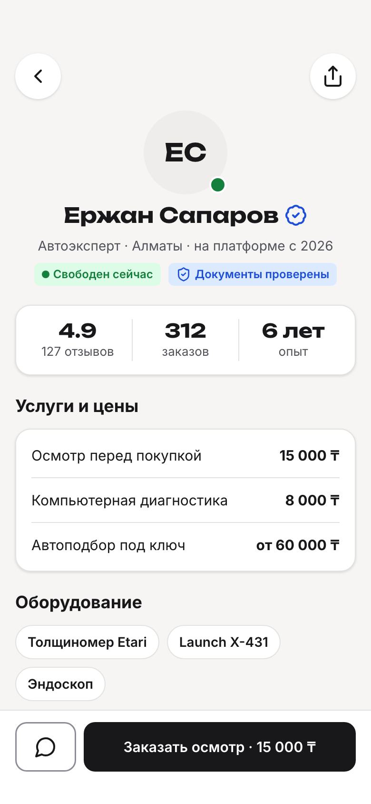

# 02 · Профиль мастера (глазами клиента)

- Эталон: [`../reference/screens/02-specialist-profile.html`](../reference/screens/02-specialist-profile.html)
- Маршрут: `src/app/specialists/[id].tsx` (stack, без таб-бара).
- Задача: убедить, что мастеру можно доверять, и показать цены до заказа.

## Разметка (сверху вниз, фон `bg`)

| Блок | Спецификация |
|---|---|
| Шапка (y 56) | Слева круглая кнопка 48 «Назад» (`chevron-back`), справа 48 «Поделиться» (`share-outline`). Обе `surface` + `shadow.card`. |
| Герой | По центру колонкой, зазор 8: аватар 88 (инициалы Unbounded 26, онлайн-точка 18) → имя `title` + значок «Проверен» 24 `trust` → «Автоэксперт · Алматы · на платформе с 2026» `bodySm` `ink2` → бейджи `success` «Свободен сейчас» и `trust` «Документы проверены». |
| Цифры (отступ 20) | Карточка, 3 равные колонки с вертикальными разделителями `border`, паддинг 14×8: значение `typography.price` (20) + подпись 13 `ink2`: «4.9 / 127 отзывов», «312 / заказов», «6 лет / опыт». |
| Услуги и цены | Заголовок `heading` «Услуги и цены» (отступ снизу 12). Карточка с паддингом 4×16, строки высотой 48 (паддинг 12), разделитель `border`: название слева `body`, цена справа Inter 700. «от» перед ценой, если цена диапазоном. |
| Оборудование | `heading` + ряд Chip (не нажимаемые, без активного состояния). |
| Отзывы | `heading` «Отзывы» + 2 ReviewCard + ссылка «Все 127 отзывов». |
| CTA-панель (низ) | Фон `surface`, линия сверху `border`, паддинг 12×16, снизу safe area. Ряд: кнопка `secondary` 52×52 с иконкой чата (`accessibilityLabel="Написать мастеру"`) + `primary` на всю оставшуюся ширину «Заказать осмотр · 15 000 ₸». |

Контент скроллится; нижний отступ контента = высота CTA-панели + 16.

## Поведение

- «Заказать» → экран 03 (мастер и услуга предвыбраны).
- Иконка чата → чат до заказа (экран 06 без блока заказа). Телефона на этом экране нет — он открывается только после принятия заказа.
- «Поделиться» → системный share со ссылкой на профиль.

## Состояния

Загрузка — скелетон героя и 3 строки услуг. Ошибка — EmptyState с «Повторить». Мастер заблокирован/удалён — EmptyState «Профиль недоступен» + «На главную». Нет сети — Banner danger сверху под шапкой.

## Тексты

`specialist.profile.services` «Услуги и цены» · `specialist.profile.equipment` «Оборудование» · `specialist.profile.reviews` «Отзывы» · `specialist.profile.allReviews` «Все {{count}} отзывов» · `specialist.profile.order` «Заказать осмотр · {{price}}» · `specialist.profile.since` «на платформе с {{year}}».
