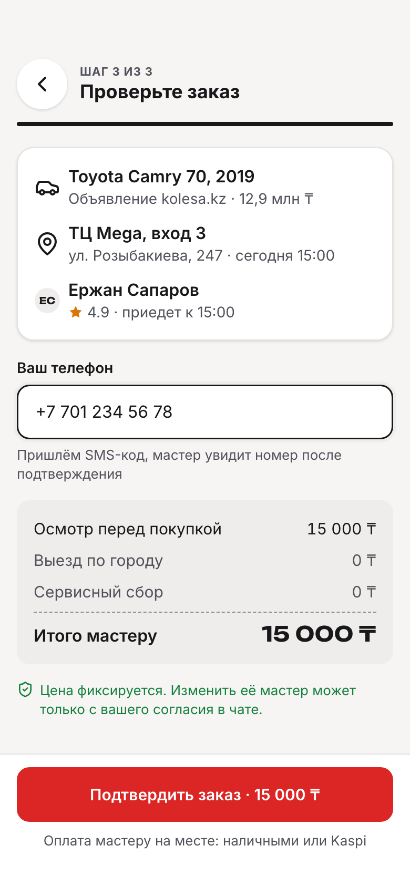

# 03 · Оформление осмотра — шаг 3 «Проверьте заказ»

- Эталон: [`../reference/screens/03-order-confirm.html`](../reference/screens/03-order-confirm.html)
- Маршрут: `src/app/orders/new.tsx`, мастер шагов (шаги 1–2 описаны в `README.md` этой папки).
- Задача: показать всё, что будет, и итоговую цену до подтверждения. Это единственный экран воронки с красной кнопкой.

## Разметка

| Блок | Спецификация |
|---|---|
| Шапка (y 56) | Кнопка «Назад» 48 + колонка: `overline` «Шаг 3 из 3» `ink2` и заголовок Inter 700 18/24 «Проверьте заказ». |
| Прогресс | Полоса 4 dp, отступы 0×16, снизу 20, фон `surface2`, заполнение `ink` (3/3 = 100%), скругление 4. |
| Сводка | Карточка, колонка с зазором 12, 3 строки «иконка 24 + заголовок Inter 600 16/22 + подпись `bodySm` `ink2`»: машина («Toyota Camry 70, 2019» / «Объявление kolesa.kz · 12,9 млн ₸»), место и время («ТЦ Mega, вход 3» / «ул. Розыбакиева, 247 · сегодня 15:00»), мастер (аватар 24 + имя / рейтинг · «приедет к 15:00»). Каждая строка нажимается → возврат к нужному шагу. |
| Телефон | TextField «Ваш телефон», подсказка «Пришлём SMS-код, мастер увидит номер после подтверждения». Если номер уже подтверждён в профиле — показывается заполненным и не редактируется (ссылка «Изменить»). |
| Цена | PriceBreakdown: строки услуги и выезда, «Сервисный сбор 0 ₸», итог «Итого мастеру». Под ним гарантия фиксированной цены. |
| CTA-панель | Button `brand` блочная «Подтвердить заказ · 15 000 ₸» + под ней 13 `ink2` по центру «Оплата мастеру на месте: наличными или Kaspi». |

Зазор между блоками — 16, поля — 16.

## Поведение

- «Подтвердить» → loading в кнопке → экран 04 (замена в стеке, «Назад» с 04 ведёт в «Заказы», не в мастер).
- Ошибка сети при отправке — кнопка возвращается в обычное состояние, Banner danger над CTA: «Заказ не отправлен. Проверьте интернет и нажмите ещё раз». Повторная отправка — идемпотентный ключ заказа.
- Мастер стал занят, пока клиент оформлял, — Banner warning «Ержан сейчас занят» + кнопки «Выбрать другого» / «Записаться на позже».

## Тексты

`orders.new.step` «Шаг {{n}} из {{total}}» · `orders.new.review` «Проверьте заказ» · `orders.new.phone` «Ваш телефон» · `orders.new.phoneHint` «Пришлём SMS-код, мастер увидит номер после подтверждения» · `orders.new.total` «Итого мастеру» · `orders.new.priceLocked` «Цена фиксируется. Изменить её мастер может только с вашего согласия в чате.» · `orders.new.confirm` «Подтвердить заказ · {{price}}» · `orders.new.payment` «Оплата мастеру на месте: наличными или Kaspi».
