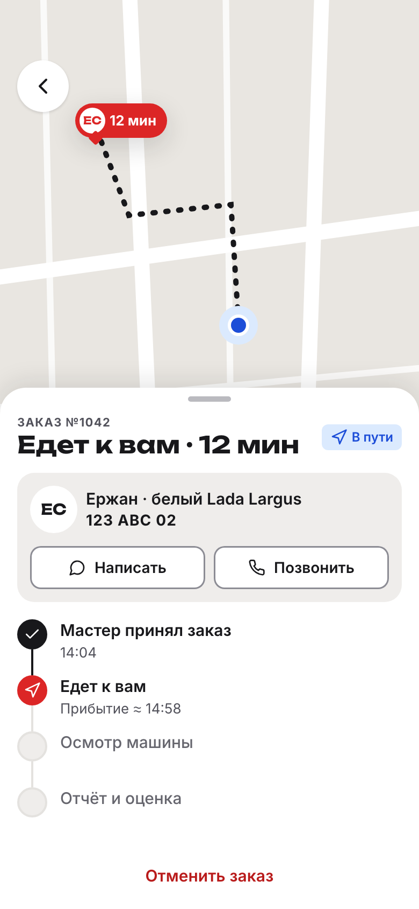

# 04 · Статус заказа

- Эталон: [`../reference/screens/04-order-tracking.html`](../reference/screens/04-order-tracking.html)
- Маршрут: `src/app/orders/[id]/index.tsx`.
- Задача: снять тревогу «а он вообще едет?» — как в такси.

## Разметка

| Блок | Спецификация |
|---|---|
| Карта (0–400 по y) | Маршрут мастера пунктиром `ink` (ширина 5, штрих 2/10, скруглённые концы). Пин мастера — MapPin «выбранный» с ETA «12 мин». Клиент — точка «Я». Кнопка «Назад» 48 слева сверху (y 56). |
| Шторка (с y 360 до низа) | Без таб-бара. Ручка, затем ряд: колонка (`overline` «Заказ №1042» + `title` «Едет к вам · 12 мин») и справа бейдж `trust` «В пути». |
| Мастер и машина | Блок `surface2` без рамки, скругление 16, паддинг 12, отступ сверху 12: аватар 44 + «Ержан · белый Lada Largus» Inter 600 15 + госномер Inter 700 14 с разрядкой 0.5 «123 ABC 02». Под ними 2 кнопки `secondary` `sm` поровну: «Написать» → 06, «Позвонить» (номер доступен, заказ принят). |
| Трекер | OrderTracker, отступ сверху 16: Мастер принял (✓ 14:04) → Едет к вам (текущий, «Прибытие ≈ 14:58») → Осмотр машины → Отчёт и оценка. |
| Отмена | Button `danger` блочная «Отменить заказ», отступ сверху 4. После статуса «На месте» скрывается. |

## Статусы и что меняется

| Статус | Заголовок | Бейдж | Карта |
|---|---|---|---|
| Ждём ответа мастера | «Ждём ответа мастера» + таймер | `warning` «Ждёт ответа» | без маршрута |
| Принят | «Мастер принял заказ» | `trust` «Принят» | — |
| В пути | «Едет к вам · N мин» | `trust` «В пути» | маршрут + ETA |
| На месте | «Мастер на месте» | `success` «На месте» | без маршрута; Banner success |
| Работа | «Идёт осмотр» | `success` «В работе» | — |
| Готово | «Осмотр завершён» | `success` «Выполнен» | кнопка `primary` «Открыть отчёт» → 05 и Rating для оценки |
| Отменён | «Заказ отменён» | `danger` «Отменён» | причина текстом |

## Приватность (решение нужно зафиксировать в ADR)

Живая позиция мастера показывается **только в статусе «В пути»** и только клиенту этого заказа; в остальное время — без точки мастера. До принятия заказа телефон мастера скрыт (кнопка «Позвонить» отсутствует).

## Состояния

Загрузка — скелетон шторки. Ошибка/нет сети — Banner danger вверху шторки; последний известный статус остаётся с подписью «обновлено в 14:52».

## Тексты

`orders.track.onTheWay` «Едет к вам · {{min}} мин» · `orders.track.arrival` «Прибытие ≈ {{time}}» · `orders.track.write` «Написать» · `orders.track.call` «Позвонить» · `orders.track.cancel` «Отменить заказ» · `orders.status.*` — названия статусов из таблицы.
