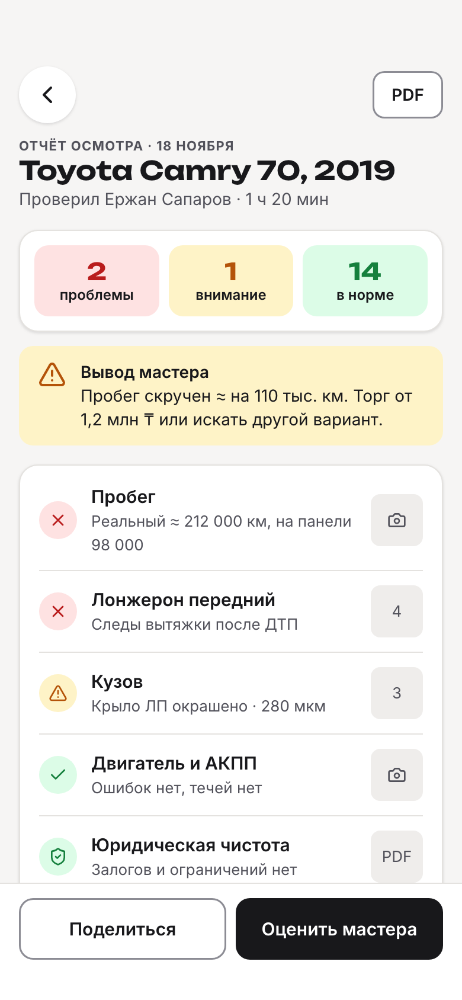

# 05 · Отчёт осмотра перед покупкой

- Эталон: [`../reference/screens/05-inspection-report.html`](../reference/screens/05-inspection-report.html)
- Маршрут: `src/app/orders/[id]/report.tsx`. Также публичная веб-ссылка на отчёт (без входа) — отдельной задачей.
- Задача: главный артефакт продукта — понятный, структурированный отчёт вместо «видео в мессенджере».

## Разметка

| Блок | Спецификация |
|---|---|
| Шапка (y 56) | «Назад» 48 слева; справа Button `secondary` `sm` «PDF» (скачать/поделиться PDF). |
| Заголовок | `overline` «Отчёт осмотра · 18 ноября» → `title` «Toyota Camry 70, 2019» → `bodySm` `ink2` «Проверил Ержан Сапаров · 1 ч 20 мин». |
| Сводка (отступ 16) | Карточка, паддинг 12, 3 равные плитки (зазор 8, скругление 12, паддинг 10×4, по центру): число `typography.price` + подпись Inter 600 12. «2 / проблемы» на `brandTint` (число `brandText`), «1 / внимание» на `warningTint` (`warning`), «14 / в норме» на `successTint` (`success`). Тап по плитке фильтрует список. |
| Вывод мастера | Banner warning (или danger, если есть критичное; success, если всё в норме), заголовок «Вывод мастера», текст — свободный вывод мастера, отступы 12×16. |
| Пункты | Карточка с паддингом 4×16, список InspectionItem: сначала `bad`, потом `warn`, потом `ok`. Сгруппировать по разделам (Кузов, Двигатель и КПП, Ходовая, Электрика, Салон, Пробег, Юридическая чистота) с `overline`-заголовком раздела, когда пунктов > 6. |
| CTA-панель | 2 кнопки поровну: `secondary` «Поделиться», `primary` «Оценить мастера» (после оценки — «Заказать ещё осмотр»). |

## Поведение

- Тап по пункту → лист с деталями: полное описание, все фото (сетка 3 колонки, по тапу полноэкранная галерея со свайпом), значения замеров.
- «Поделиться» → системный share: ссылка на веб-версию отчёта.
- «PDF» → генерация на сервере, затем share-sheet.

## Состояния

Отчёт ещё не готов (мастер заполняет) — EmptyState с иконкой `time-outline`: «Мастер заполняет отчёт», «Обычно это 10–20 минут после осмотра». Ошибка/нет сети — как везде; уже загруженный отчёт доступен офлайн (кэш).

## Тексты

`report.title` «Отчёт осмотра · {{date}}» · `report.by` «Проверил {{name}} · {{duration}}» · `report.problems` «проблемы» · `report.attention` «внимание» · `report.ok` «в норме» · `report.verdict` «Вывод мастера» · `report.share` «Поделиться» · `report.rate` «Оценить мастера». Для чисел — плюрализация i18next (ru: one/few/many, kk).
