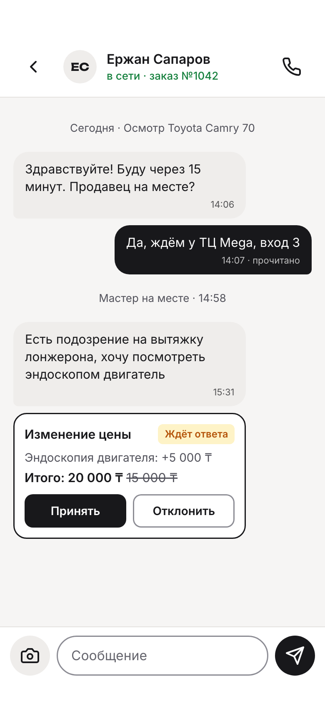

# 06 · Чат по заказу

- Эталон: [`../reference/screens/06-chat.html`](../reference/screens/06-chat.html)
- Маршрут: `src/app/chats/[id].tsx` (общий для клиента и мастера).
- Задача: заменить мессенджер — договорённости и изменения цены сохраняются в заказе.

## Разметка

| Блок | Спецификация |
|---|---|
| Шапка | Фон `surface`, линия снизу `border`, сверху safe area + 12, паддинг снизу 12. «Назад» 48 (без тени) → аватар 40 → колонка: имя Inter 600 16/22, статус Inter 500 13/18 `success` «в сети · заказ №1042» (или `ink2` «был(а) в 14:10») → справа «Позвонить» 48 (только если заказ принят). |
| Лента | Паддинг 16, зазор 8. ChatBubble: системные (дата, создание заказа, «Мастер на месте · 14:58»), входящие, исходящие с «прочитано». Новые снизу, `FlatList inverted`. |
| Предложение | Offer: «Изменение цены», бейдж «Ждёт ответа», «Эндоскопия двигателя: +5 000 ₸», «Итого: 20 000 ₸» и зачёркнутые «15 000 ₸», кнопки «Принять» / «Отклонить». |
| Поле ввода (низ) | Фон `surface`, линия сверху `border`, паддинг 10×12, снизу safe area. Ряд с зазором 8: кнопка 48 `surface2` «Прикрепить фото» (`camera-outline`) → поле (мин. высота 48, скругление 24, растёт до 5 строк) → кнопка 48 `action` «Отправить» (`send`, цвет `onAction`). Пустое поле — кнопка отправки disabled. |

## Поведение

- Клавиатура: `KeyboardAvoidingView`, поле прилипает к клавиатуре, лента скроллится к последнему.
- Отправка: пузырь сразу появляется с временем и статусом «отправляется» (иконка часов 11); ошибка — красная иконка и «Не отправлено. Повторить».
- Предложение создаёт только мастер (кнопка «+» → «Изменить цену/время»). Клиент принимает → сумма заказа меняется, системное сообщение «Цена изменена: 20 000 ₸». Отклоняет → системное «Клиент отклонил изменение цены».
- Фото: до 10 штук, превью сеткой в пузыре, тап — галерея.
- Номера телефонов и ссылки в тексте до принятия заказа не делаются кликабельными (защита от ухода из платформы — по правилам продукта).

## Состояния

Загрузка — 3 скелетона пузырей. Пусто — системное сообщение по центру «Напишите мастеру — ответ обычно за несколько минут». Нет сети — Banner danger под шапкой; исходящие ставятся в очередь.

## Тексты

`chat.online` «в сети» · `chat.lastSeen` «был(а) в {{time}}» · `chat.placeholder` «Сообщение» · `chat.attach` «Прикрепить фото» · `chat.send` «Отправить» · `chat.offer.price` «Изменение цены» · `chat.offer.waiting` «Ждёт ответа» · `chat.offer.accept` «Принять» · `chat.offer.decline` «Отклонить» · `chat.read` «прочитано».
