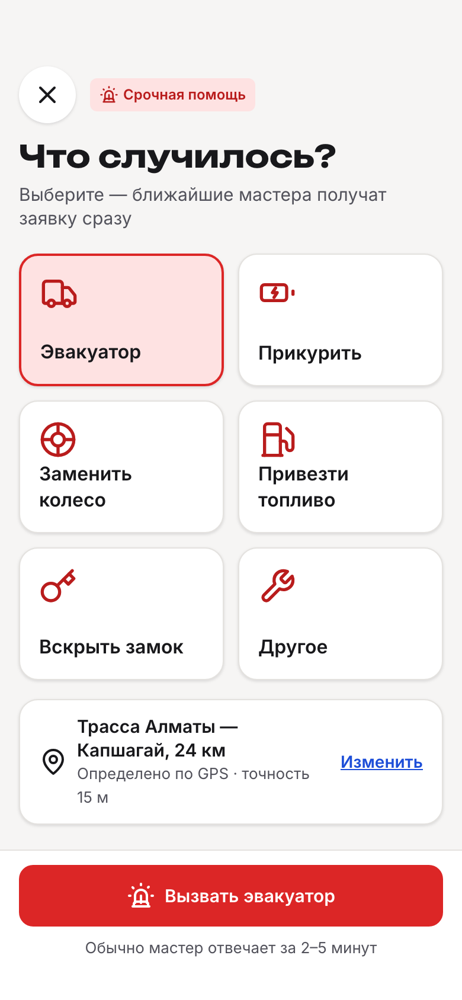

# 07 · SOS — помощь на дороге

- Эталон: [`../reference/screens/07-sos.html`](../reference/screens/07-sos.html)
- Маршрут: `src/app/sos.tsx`, `presentation: "modal"` (fullScreen на Android).
- Задача: человек в стрессе на обочине, возможно ночью и в мороз, вызывает помощь за 2 нажатия.

## Разметка

| Блок | Спецификация |
|---|---|
| Шапка (y 56) | Кнопка «Закрыть» 48 (`close`) + бейдж `danger` высотой 28 «Срочная помощь» с иконкой SOS 16. |
| Заголовок | `title` 26/32 (увеличенный) «Что случилось?» + `bodySm` 15 `ink2` «Выберите — ближайшие мастера получат заявку сразу», отступ снизу 20. |
| Плитки | Сетка 2×3, зазор 12. Плитка: высота 112, скругление 16, рамка 1 `border`, фон `surface`, `shadow.card`, паддинг 16; иконка 32 `brandText` сверху слева, подпись Inter 600 16/22 снизу слева. Выбранная: рамка 2 `brand`, фон `brandTint`. Варианты: Эвакуатор, Прикурить, Заменить колесо, Привезти топливо, Вскрыть замок, Другое. |
| Адрес | Карточка паддинг 12×16, отступ сверху 16: иконка `location-outline` + «Трасса Алматы — Капшагай, 24 км» Inter 600 15 + «Определено по GPS · точность 15 м» 13 `ink2`; справа ссылка «Изменить» (→ выбор точки на карте). |
| CTA-панель | Button `brand` блочная с иконкой SOS: текст зависит от плитки — «Вызвать эвакуатор», «Вызвать помощь: прикурить»…; под кнопкой 13 `ink2` «Обычно мастер отвечает за 2–5 минут». |

«Другое» → под плитками появляется поле «Опишите коротко» (TextField, 2 строки).

## Поведение

- Геопозиция запрашивается сразу при открытии; пока определяется — «Определяем, где вы…» со спиннером 16 в карточке адреса; кнопка доступна, адрес уточнится.
- Не вошёл в аккаунт → после нажатия CTA — вход/подтверждение телефона одним шагом, затем заявка отправляется автоматически.
- После отправки → экран 04 в статусе «Ждём ответа мастера», заявка рассылается мастерам рядом с бейджем «Срочно».
- Нет сети → заявка в очередь, Banner danger «Нет интернета. Заявка отправится, когда сеть появится» + кнопка «Позвонить 112» (`secondary`) — экстренный номер РК.
- Никаких анимаций-пульсаций; вибрация при отправке — короткая (`Haptics.notificationAsync(Success)`).

## Тексты

`sos.badge` «Срочная помощь» · `sos.title` «Что случилось?» · `sos.subtitle` «Выберите — ближайшие мастера получат заявку сразу» · `sos.type.tow|jump|tire|fuel|lock|other` · `sos.locating` «Определяем, где вы…» · `sos.accuracy` «Определено по GPS · точность {{m}} м» · `sos.cta.tow` «Вызвать эвакуатор» · `sos.eta` «Обычно мастер отвечает за 2–5 минут» · `sos.call112` «Позвонить 112».
