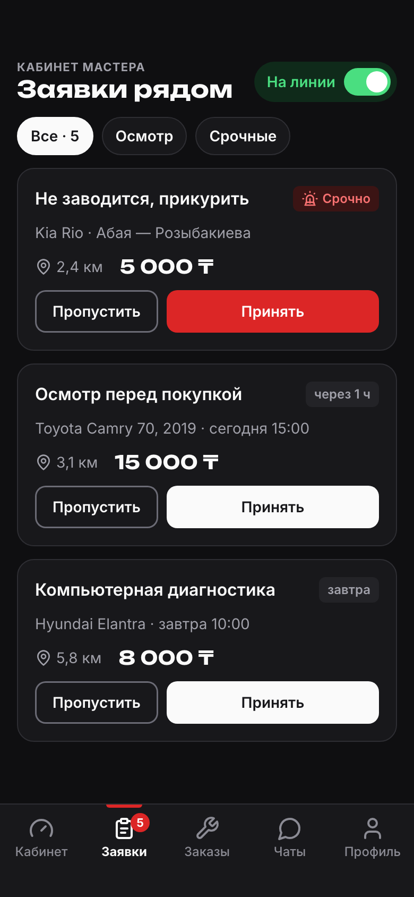

# 08 · Заявки мастера (показано в тёмной теме)

- Эталон: [`../reference/screens/08-specialist-feed-dark.html`](../reference/screens/08-specialist-feed-dark.html)
- Маршрут: `src/app/specialist/feed.tsx`, вкладка «Заявки» режима мастера.
- Задача: мастер за секунду видит, что рядом, сколько платят и что срочно, и принимает одной кнопкой.
- Экран нарисован в **тёмной теме** — это эталон тёмной темы для всего приложения (те же компоненты, токены `colors.dark`).

## Разметка

| Блок | Спецификация |
|---|---|
| Шапка (y 56) | Слева колонка: `overline` «Кабинет мастера» + `title` «Заявки рядом». Справа переключатель «На линии»: капсула `successTint`, текст Inter 600 14 `success`, свитч 44×26 (`success`, бегунок 20 белый). Выключен — капсула `surface2`, текст `ink2` «Не на линии», свитч `borderStrong`. |
| Фильтры | Chip: «Все · 5» (активный), «Осмотр», «Срочные»; отступ снизу 12. |
| Список | Колонка карточек с зазором 12 (`FlatList`, pull-to-refresh). |
| Карточка заявки | Карточка, колонка с зазором 10: ряд «услуга Inter 600 16/22 — бейдж» (срочная: `danger` «Срочно» с иконкой SOS; плановая: `neutral` со сроком «через 1 ч» / «завтра») → машина и место `bodySm` `ink2` → ряд: расстояние (иконка `location-outline` 16 + `bodySm`) и цена `typography.price` 18 → ряд кнопок `sm`: `secondary` «Пропустить» (1 доля) и «Принять» (2 доли; `brand` для срочной, `primary` для плановой). |
| Таб-бар | BottomNav мастера, активна «Заявки», счётчик = новые заявки. |

## Поведение

- Новая срочная заявка — сверху списка, короткая вибрация и push. Звук — по настройке.
- «Принять» → loading → карточка уезжает (fade 150 мс), заказ появляется во вкладке «Заказы», открывается экран заказа мастера (как 04, но с кнопками «Еду», «На месте», «Заполнить отчёт»).
- Заявку уже взял другой → Banner warning в карточке «Заявку уже принял другой мастер», карточка исчезает через 2 с.
- «Не на линии» → список заменяется EmptyState «Вы не на линии» + кнопка «Выйти на линию».
- Мастер не верифицирован → вместо списка Banner info «Профиль на проверке. Заявки появятся после проверки документов» + ссылка на профиль.

## Состояния

Загрузка — 3 скелетона карточек. Пусто — EmptyState «Пока заявок рядом нет», «Мы пришлём уведомление, как только появится новая». Ошибка/нет сети — Banner danger над списком.

## Тексты

`specialist.feed.title` «Заявки рядом» · `specialist.feed.online` «На линии» · `specialist.feed.offline` «Не на линии» · `specialist.feed.all` «Все · {{count}}» · `specialist.feed.urgent` «Срочно» · `specialist.feed.skip` «Пропустить» · `specialist.feed.accept` «Принять» · `specialist.feed.taken` «Заявку уже принял другой мастер».
